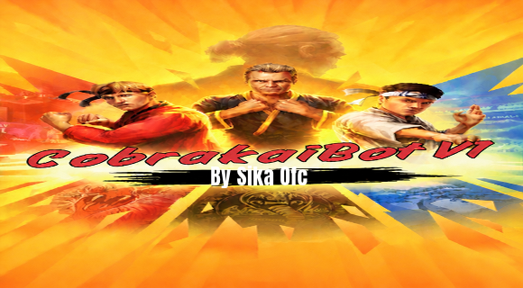

<div align="center" id="top"> 
</div>

<p align="center">
  <br>
  <code>======================================</code><br>
  <b><font size="6">COBRAKAI BOT V1 - BY SIKA OFC</font></b><br>
  <code>======================================</code>
</p>

<div align="center">
<p align="center">
    <a href="https://www.youtube.com/@prog_sikaofc">
        
    </a>
    <a href="https://t.me/md_sikadojo">
        
    </a>
    <a href="https://sikadojoweb.kesug.com">
        
    </a>
    <a href="mailto:programadorgamer025@gmail.com">
        
    </a>
    <a href="https://www.paypal.com/paypalme/SikaOfc">
        
    </a>
</p>
</div>

 <h4 align="center"> 
	🐍 CobraKaiBot 🚀 Strike First. Strike Hard. No Mercy. 🦅
</h4>

## 🥋 Acerca del dojo (Bot)

Bot de WhatsApp Multi-Dispositivo de alto rendimiento creado con Node.js con temática tributo a **Cobra Kai**.

Permite gestionar grupos con búsqueda de información, descarga de aplicaciones propias desarrolladas por *SikaOfc*, herramientas multimedia e inteligencia artificial, además de contar con un sistema de registro y minijuegos del torneo All Valley con fines recreativos y educativos.

Diseñado por _SikaOfc_ para conquistar grupos y chats privados.

Si el bot te ayuda a dominar el tatami, deja una ⭐ en el repositorio. ¡Eso ayuda a mantener el proyecto activo y en constante mejora!

📥 Apoya el proyecto (donaciones voluntarias): [PayPal - @SikaOfc](https://www.paypal.com/paypalme/SikaOfc)

## 📌 Arsenal de Comandos Principales

A continuación se muestran las técnicas y comandos más letales disponibles en **CobraKaiBot V1**:

<details>
<summary><b>🥋 Lista de Prefijos Permitidos (Golpea con el que prefieras)</b></summary>

<br>

| Modo              | Prefijo | Ejemplo |
| ----------------- | ------- | ------- |
| **Privado/Grupo** | /       | `/menu` |
| **Privado/Grupo** | .       | `.menu` |
| **Privado/Grupo** | #       | `#menu` |
| **Privado/Grupo** | !       | `!menu` |

</details>

<details>
<summary><b>👥 Comandos de Combate (Privado y Grupo)</b></summary>

<br>

| Modo              | Comando             | Características                      |
| ----------------- | ------------------- | ------------------------------------ |
| **Privado/Grupo** | `/start o /menu`    | Entrar al dojo - Menú principal      |
| **Privado/Grupo** | `/ping`             | Medir velocidad de reflejos          |
| **Privado/Grupo** | `/creador`          | Conocer al Gran Sensei               |
| **Privado/Grupo** | `/repo` o `/github` | Clonar el código del dojo            |
| **Grupo**         | `/extgrup`          | Panel de control para Senseis/Admins |
| **Grupo**         | `/appsyextra`       | Arsenal de APKs e IA                 |

</details>

## ⚙️ Requisitos de Entrenamiento (Herramientas)

- Node.js (Para compilar y ejecutar la fuerza del bot)
- FFmpeg (Obligatorio para entrenar audios y videos del dojo)
- Un editor de código o IDE (Visual Studio Code)
- Consola de comandos: PowerShell 7
- APIs: Google Cloud Console, Custom Search y Unsplash

## 🛠️ Lenguajes y Tecnologías del Tatami

- [Node.js](https://nodejs.org/es)
- [FFmpeg](https://www.gyan.dev/ffmpeg/builds/ffmpeg-release-essentials.zip)
- [Git](https://git-scm.com/)
- [Visual Studio Code](https://code.visualstudio.com/)
- [PowerShell 7](https://github.com/powershell/powershell/releases)
- [Unsplash](https://unsplash.com/oauth/applications)
- [Google Cloud Console](https://console.cloud.google.com)
- [Custom Search](https://programmablesearchengine.google.com/controlpanel/all)

## 🪟 Instalación en Windows (PowerShell 7)

<details>
<summary><b>⚙️ Programas requeridos para el combate (Obligatorio 🛠️)</b></summary>

- **Node.js:** Descargar de [nodejs.org](https://nodejs.org/es) y agregarlo al PATH.
- **Git:** Descargar de [git-scm.com](https://git-scm.com/) y agregarlo al PATH.
- **Python:** Descargar de [python.org](https://www.python.org/) y agregarlo al PATH.
- **FFmpeg:** Descargar de [ffmpeg.org](https://www.gyan.dev/ffmpeg/builds/ffmpeg-release-essentials.zip) y agregarlo al PATH.

</details>

```powershell
# Nota: Asegúrate de tener instalado previamente: Node.js, Git, Python y FFmpeg (añadidos al PATH).

# 1. Configurar la política de ejecución de scripts en tu sesión actual de PowerShell
Set-ExecutionPolicy -ExecutionPolicy RemoteSigned -Scope Process -Force

# 2. Clonar el repositorio del dojo y entrar al directorio
git clone https://github.com/programador024/CobraKaiBot-WA.git
cd CobraKaiBot-WA

# 3. Configurar NPM para permitir scripts nativos y descargas desde Git
npm config set ignore-scripts false
npm config set allow-git all

# 4. Instalar las dependencias de Node.js del dojo
npm install --legacy-peer-deps --allow-git=all

# 5. Instalar/Actualizar yt-dlp para el motor global de descargas
pip install --upgrade yt-dlp

# 6. ¡Strike First! Iniciar CobraKaiBot V1
npm start

# --- COMANDOS ÚTILES DE CONTROL ---
# Reiniciar el bot:       npm restart
# Detener el bot:        Presiona la combinación de teclas Ctrl + C
```

## ☁️ Instalación en Ubuntu (Google Cloud / VPS)

```bash
# 1. Actualizar el sistema y dependencias de combate base (esencial para better-sqlite3 y yt-dlp)
sudo apt update && sudo apt upgrade -y
sudo apt install -y git ffmpeg build-essential curl python3 python3-pip

# 2. Instalar la versión LTS recomendada de Node.js (Repositorio oficial de NodeSource)
curl -fsSL https://deb.nodesource.com/setup_20.x | sudo -E bash -
sudo apt install -y nodejs

# 3. Clonar el repositorio del dojo y entrar al directorio
git clone https://github.com/programador024/CobraKaiBot-WA.git
cd CobraKaiBot-WA

# 4. Configurar NPM para habilitar instaladores nativos y soporte Git en la nube
npm config set ignore-scripts false
npm config set allow-git all

# 5. Instalar los módulos del proyecto de forma segura
npm install --legacy-peer-deps --allow-git=all

# 6. Instalar/Actualizar yt-dlp globalmente para respaldo de multimedia
sudo pip3 install --upgrade yt-dlp

# 7. Reconstruir la base de datos SQLite para entornos Linux Cloud
npx node-gyp rebuild --directory=node_modules/better-sqlite3

# 8. Ejecutar CobraKaiBot V1 de forma manual
npm start

# --- COMANDOS ÚTILES DE CONTROL ---
# Reiniciar el bot:       npm restart
# Detener el bot:        Presiona la combinación de teclas Ctrl + C
# Para mantenerlo activo 24/7 sin piedad, revisa la sección de PM2 más abajo.
```

## 📱 Instalación en Termux (Móvil / Tablet / Emulador)

<details>
<summary><b>🔋 ¿Cómo evitar que Android cierre Termux (Ahorro de Batería)?</b></summary>
Android suele cerrar las aplicaciones en segundo plano para ahorrar batería, lo que desconectará tu bot. Para evitarlo, sigue estos pasos en tu teléfono:

1. **Bloquear Termux en Recientes:** Abre tu multitarea (apps recientes), mantén presionado el ícono de **Termux** y selecciona **"Bloquear aplicación"** (Candado 🔒) para que el sistema no la mate al limpiar memoria.
2. **Desactivar Optimización de Batería:**
   - Ve a los **Ajustes** de tu teléfono ⚙️.
   - Busca **Aplicaciones** -> **Termux**.
   - Entra en **Ahorro de batería** o **Uso de batería en segundo plano**.
   - Selecciona **"Sin restricciones"** o **"Permitir uso sin restricciones"**.
   </details>

```bash
# 1. Otorgar permisos de almacenamiento en Android
termux-setup-storage

# 2. Actualizar repositorios e instalar dependencias (incluye python y python-pip para yt-dlp)
pkg update && pkg upgrade -y
pkg install -y nodejs-lts git ffmpeg python python-pip make clang pkg-config build-essential libvips

# 3. Clonar el repositorio del dojo y entrar al directorio
git clone https://github.com/programador024/CobraKaiBot-WA.git
cd CobraKaiBot-WA

# 4. Configurar NPM para permitir instaladores nativos y soporte Git completo
npm config set ignore-scripts false
npm config set allow-git all

# 5. Instalar los módulos del proyecto
npm install --legacy-peer-deps --allow-git=all

# 6. Instalar/Actualizar yt-dlp en Termux para el motor de descarga
pip install --upgrade yt-dlp

# 7. Reconstruir de forma explícita la base de datos SQLite (¡aquí compila perfecto gracias a python, make y clang!)
npx node-gyp rebuild --directory=node_modules/better-sqlite3

# 8. Prevenir la suspensión de la CPU de Android en segundo plano
termux-wake-lock

# 9. Iniciar el bot en modo manual
npm start

# --- EJECUCIÓN 24/7 SIN PIEDAD CON PM2 EN TERMUX ---

# 1. Asegúrate de estar en la carpeta del bot
cd ~/CobraKaiBot-WA

# 2. Instalar PM2 globalmente en Termux
npm install -g pm2

# 3. Activar el escudo contra suspensión de CPU (crucial)
termux-wake-lock

# 4. Iniciar el bot en segundo plano con PM2
pm2 start index.js --name "cobrakai-bot"

# Comandos útiles de administración con PM2:
# - Ver estado del dojo:    pm2 status
# - Ver logs en vivo:       pm2 logs cobrakai-bot
# - Detener el bot:         pm2 stop cobrakai-bot
# - Reiniciar el bot:       pm2 restart cobrakai-bot
# - Eliminar proceso:       pm2 delete cobrakai-bot
```

## 🦅 Para dejarlo 24/7 en Google Cloud (Ubuntu con PM2)

```bash
# 1. Asegúrate de estar dentro de la carpeta del bot
cd ~/CobraKaiBot-WA

# 2. Instalar PM2 de forma global en el sistema
sudo npm install -g pm2

# 3. Iniciar el bot con PM2 bajo el nombre oficial del dojo
pm2 start index.js --name "cobrakai-bot"

# 4. Configurar el inicio automático si el servidor sufre un apagón
pm2 startup
# (Nota: Copia y ejecuta en la terminal el comando con 'sudo' que te arroje este paso).

# 5. Guardar la configuración de procesos permanentes
pm2 save

# --- COMANDOS ÚTILES DE MONITOREO ---
# Ver estado del dojo
pm2 status

# Ver registros en tiempo real (Escaneo de código QR / Actividad del chat)
pm2 logs cobrakai-bot

# Reiniciar bot
pm2 restart cobrakai-bot

# Detener el bot
pm2 stop cobrakai-bot

# Eliminar proceso
pm2 delete cobrakai-bot
```
## 🔐 Configuración de `.env` y Motores VIP

Al ejecutar el bot por primera vez (`npm start`), `config.js` crea automáticamente un archivo `.env` si aún no existe (y `.env` está ignorado en `.gitignore` para proteger tus claves).

- Si dejas las claves vacías, comandos como `/search` e `/img` seguirán funcionando usando respaldos gratuitos.
- Si agregas tus propias API Keys, se activan los motores VIP correspondientes y se muestra su estado en `/vip`.

### Variables disponibles en `.env`

| Variable | Función | Motor / Uso |
| :--- | :--- | :--- |
| `SERPER_API_KEY` | Búsqueda web VIP | `/search` (con respaldo en DuckDuckGo y Wikipedia) |
| `UNSPLASH_ACCESS_KEY` | Búsqueda de imágenes VIP | `/img` |
| `GOOGLE_API_KEY` + `GOOGLE_CX` | Google Custom Search de imágenes | `/img` |
| `PEXELS_API_KEY` | Búsqueda de imágenes VIP (respaldo) | `/img` |
| `PIXABAY_API_KEY` | Búsqueda de imágenes VIP (respaldo) | `/img` |

> **Importante al editar `.env`:** Escribe cada clave directamente después del `=`, **sin comillas** ni **punto y coma (`;`)**, una por línea. Ejemplo:
> ```env
> SERPER_API_KEY=tu_clave_aqui
> ```

## 📄 Licencia y Aviso Legal

Este proyecto está bajo una licencia de uso personal, educativo y no comercial. ¡Sin piedad con las copias no autorizadas!

Todos los derechos del código fuente reservados © 2026 [SikaOfc](https://github.com/programador024)

> Consulta el archivo [LICENSE](./LICENSE) para más detalles.

- ✅ Uso personal, educativo y en grupos permitido
- ✅ Donaciones voluntarias para el mantenimiento del proyecto
- ❌ Prohibida su venta, reventa o uso comercial

### ⚖️ Descargo de Responsabilidad (Disclaimer)
* **Proyecto Tributo (Fan-Made):** Este bot es un proyecto independiente creado por fans con fines estrictamente educativos y de entretenimiento. Los nombres, logotipos, personajes y referencias a *Cobra Kai* y *The Karate Kid* son marcas registradas pertenecientes a **Sony Pictures Television** y sus respectivos propietarios. No existe afiliación oficial ni ánimo de lucro comercial con la franquicia.
* **Herramientas Multimedia:** Las funciones de búsqueda y descarga multimedia están diseñadas únicamente para uso personal y educativo. El desarrollador no se hace responsable del mal uso que los usuarios finales puedan darle a estas herramientas respecto a derechos de autor de terceros.

&#xa0;

<h2 tabindex="-1" class="heading-element" dir="auto">Rachas-Contribución y Lenguaje </h2>

<p align="center">
<table align="left">
<tr border="none">
<td width="60%" align="center">
   
</td>

<td width="40%" align="center">
  <!-- Muestra el lenguaje del repositorio específico del bot de WhatsApp -->
 
</td>
</tr>
</table>
</p>

  <br>
<br><br>

<a href="#top">Volver arriba 🦅</a>
